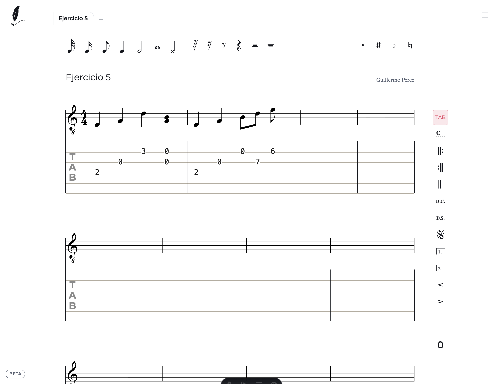

# Partitura

Editor de partituras online, gratis y sin registro. Una página en blanco donde escribir notas, silencios, compases,
clave y armadura, con tablatura de guitarra, y descargar el resultado en PDF o MusicXML.

Disponible en español, inglés y portugués, y renderizado en el servidor para que todo el contenido sea indexable.




## Características

- **Notas y silencios** de redonda a fusa, con puntillo y alteraciones (sostenido, bemol, becuadro).
- **Compases** (4/4, 3/4, 6/8…) con control de duración: no deja pasarse del compás.
- **Clave y armadura**: Sol, Fa o Do, y cualquier armadura de Do♭ a Do♯.
- **Barras especiales**: doble, de repetición y cejillas para guitarra.
- **Tablatura de guitarra** editable: cambiar el traste, mover una celda de cuerda o de tiempo, y recolocar la digitación sin alterar el sonido.
- **Atajos de teclado** para cada figura, duplicar selección y más.
- **Varias partituras en pestañas** con guardado automático en el navegador (IndexedDB).
- **Exportación** a PDF para imprimir y a MusicXML para abrir en MuseScore, Finale, Sibelius o Dorico.
- **Tutoriales** por tema, en tres idiomas.

## Stack

[Astro](https://astro.build) (salida estática) · [Verovio](https://www.verovio.org) (engraving, WebAssembly) ·
jsPDF (PDF) · React + Radix UI (toasts y diálogos).

## Empezar

Requiere Node >= 22.12 (ver `.nvmrc`).

```sh
npm install
npm run dev
```

```sh
npm run build   # sitio estático en dist/; SITE_URL=https://ejemplo.com para el dominio de canonical, hreflang y sitemap
npm test        # después del build: verifica el HTML generado
npm run check   # astro check (tipos)
```
