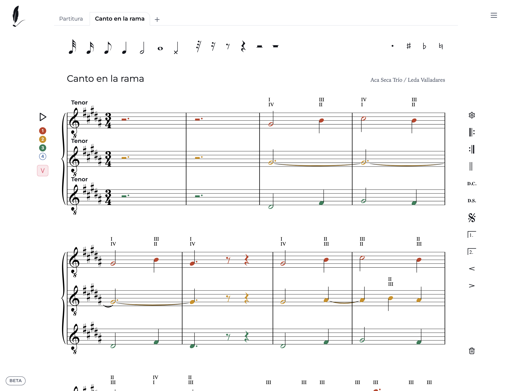
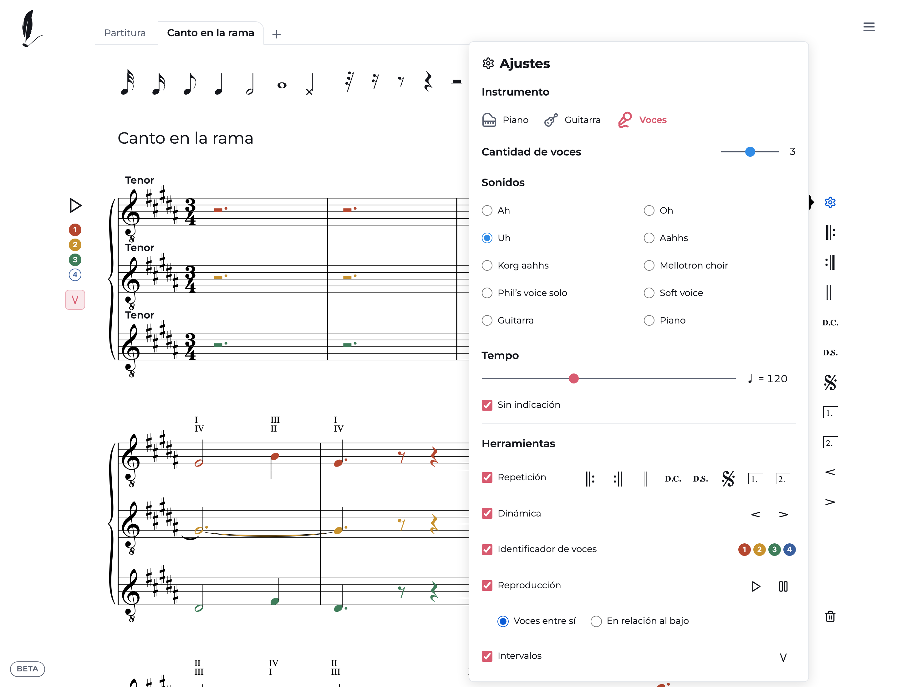

# Partitura

**Editor de partituras online, gratis y sin registro.** Escribí notas, silencios, compases, clave y armadura directo en el pentagrama, sin instalar nada, y descargá tu partitura en PDF o MusicXML.

👉 **[partitura.com.ar](https://partitura.com.ar)** · [Probar la demo «Canto en la rama»](https://partitura.com.ar/es/demos/canto-en-la-rama/?tools=voices,play,intervals&sound=uh&banner=hide)

## Características

- **Escribí como pensás:** arrastrá una figura al pentagrama o elegila y hacé clic donde va. Redondas a fusas, puntillos, alteraciones y atajos de teclado para todo.
- **Piano, guitarra o coro:** gran pentagrama para piano, tablatura editable para guitarra y hasta cuatro voces para coro.
- **Mirá cómo suena:** reproducí tu partitura con sonidos de piano, guitarra o coro, con una barra que sigue la música y arranca donde hagas clic.
- **Voces en color:** distinguí cada línea musical, escuchala por separado y mirá los intervalos entre voces.
- **Repeticiones y dinámicas:** barras de repetición, D.C., D.S., segno, casas 1. y 2., reguladores.
- **Acordes de guitarra** con su digitación sobre el pentagrama.
- **Todas tus partituras a mano:** pestañas para alternar entre borradores, con guardado automático en tu navegador.
- **Llevate tu trabajo:** exportá a PDF para imprimir, o a MusicXML y MIDI para seguir en MuseScore, Finale, Sibelius o Dorico. También podés importarlos arrastrando el archivo.
- **Aprendé con tutoriales** paso a paso, en español, inglés y portugués.
